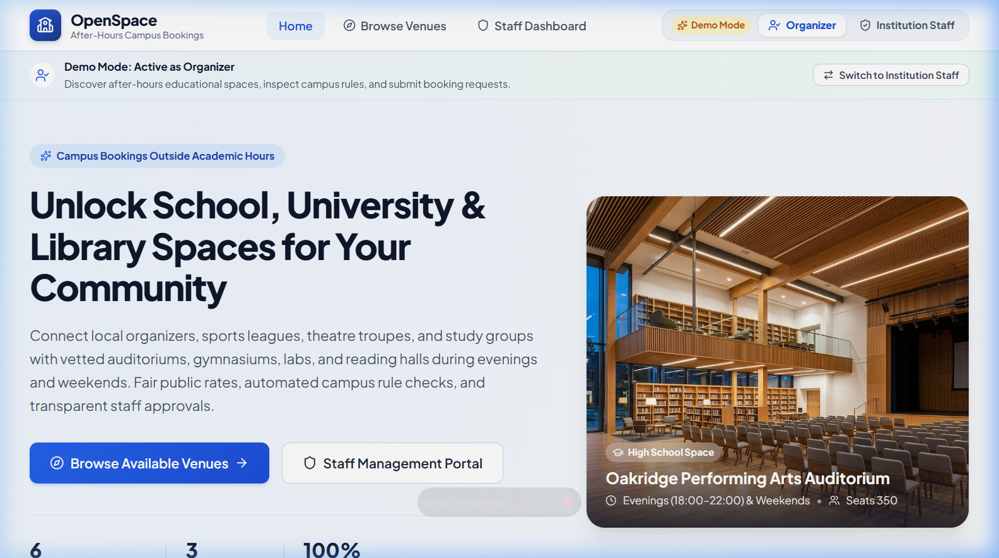
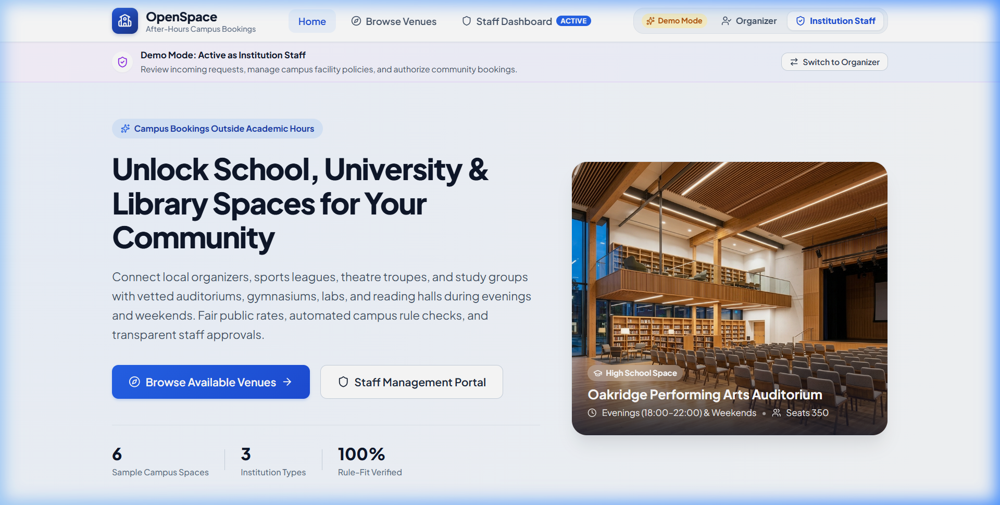
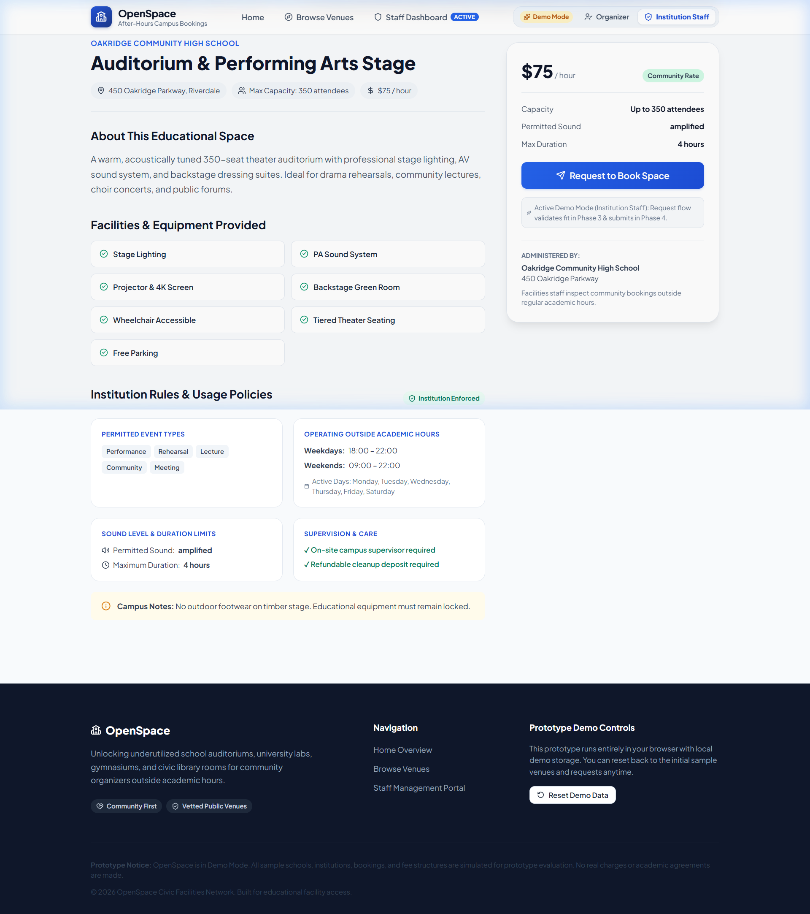
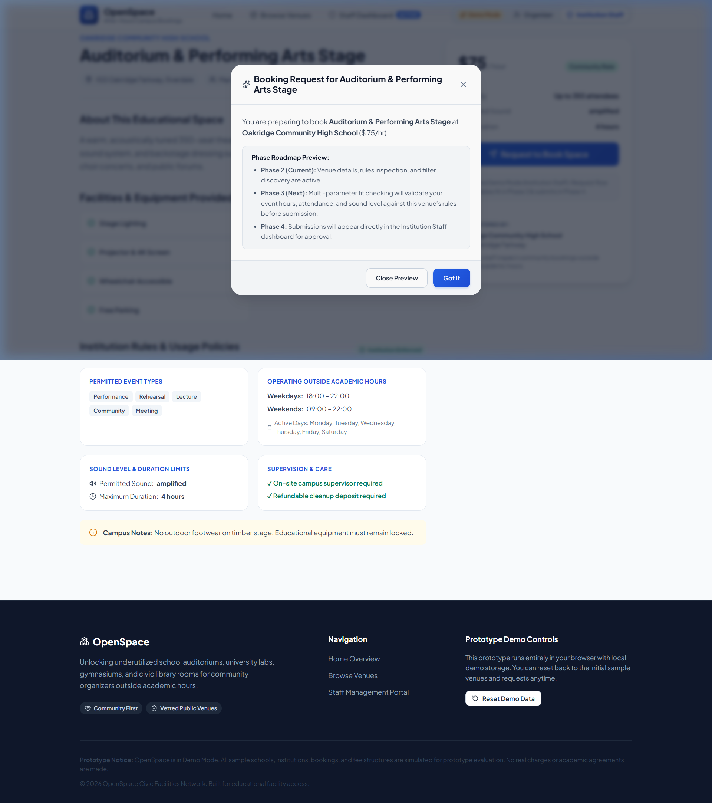
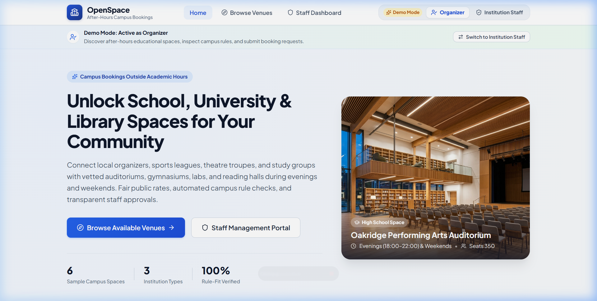

# OpenSpace — After-Hours Campus & Civic Venue Booking

> **Built for Next Byte Hacks V5**  
> A civic tech platform unlocking dark school, university, and library spaces for evening and weekend community use — with real-time policy evaluation, schedule conflict prevention, weekly calendar timelines, and recurring permits.

[](https://github.com/pie-script/OpenSpace)
[](https://github.com/pie-script/OpenSpace)
[](https://react.dev)
[](https://www.typescriptlang.org)
[](https://vitejs.dev)

---

## 🌟 The Problem

Every evening and weekend, tens of thousands of publicly funded classrooms, auditoriums, media labs, and gymnasiums sit locked and dark. Meanwhile:
- **Grassroots organizers, non-profits, and youth groups** struggle to find safe, affordable spaces for rehearsals, workshops, and sports clinics.
- **School administrators and facilities staff** are hesitant to open their doors due to concerns about supervision, liability, noise compliance, and double-booking disasters.

**OpenSpace** bridges this gap: a transparent, responsive platform tailored to educational institutions that enforces institutional safety rules upfront, prevents schedule overlaps before requests are submitted, and gives campus staff full administrative oversight.

---

## ✨ Key Features

### 1. 🏫 Educational & Civic Facility Discovery
- Curated catalog of community spaces across **High Schools, Universities, and Public Libraries**.
- Multi-dimensional filtering by date, capacity, event category, price, and specialized amenities (A/V booths, sprung hardwood, projectors, sound dampening).
- High-contrast, responsive card views with facility badge tags and instant query resets.

### 2. ⚖️ Rule Fit Evaluation Engine
- Pre-submission compliance checks evaluating proposed events against individual facility policies.
- Instant feedback on **operating hours, permitted event types, max attendance, sound levels, and custodial supervision requirements**.
- Clear diagnostic warnings showing why an event does or does not fit a space before any paperwork is filed.

### 3. 🛡️ Booking Request Lifecycle & Conflict Prevention
- Complete status workflow: **Pending ➔ Approved ➔ Declined ➔ Cancelled**.
- **Automated Conflict Detection**: Evaluates half-open time intervals `[start, end)` to detect double-booking overlaps.
- Prevents staff from approving overlapping reservations while keeping slots open if requests are declined or cancelled.

### 4. 📅 Interactive Weekly Calendar Timeline
- Visual 7-day Monday–Sunday timeline grid mapped from **08:00 to 22:00**.
- Color-coded event blocks (**Approved** in emerald, **Pending** in amber, **Conflict** in pulsing red).
- Facility selector dropdown and quick navigation buttons (`Previous Week`, `Next Week`, and `Demo Week`).
- Interactive event card popover displaying organizer details, attendance, noise levels, and inline staff approval controls.

### 5. 🔁 Recurring Series & Batch Conflict Checking
- Request multi-week recurring bookings (**Weekly** or **Bi-weekly** for 2–8 sessions).
- Automated batch conflict detection evaluating every single session date across month boundaries.
- Live series availability preview showing open vs conflicting dates.
- Shared `seriesId` tracking across the platform (e.g. `Series (1 of 4)` badges).

### 6. 🔔 In-App Notification Center
- Header notification bell with live unread counter badge.
- Interactive notification drawer displaying permit approvals, decline reasons, and conflict warnings.
- Filter by **All** vs. **Unread**, mark items as read, or clear alerts.

### 7. 📊 Export & Executive Summary Reporting
- **RFC 4180 CSV Export**: One-click download of all booking requests, recurring links, and permit notes for spreadsheets.
- **Printable Executive Summary Report**: Printable dialog (`@media print` optimized) computing total bookings, approved hours, attendee counts, and revenue generated by facility.

### 8. 🎭 Seamless Demo Mode Role Switcher
- Instantly switch between **Community Organizer** and **Institution Staff** roles directly in the header.
- Persistent local storage (`localStorage`) with sample data and a one-click **Reset Demo Data** button in the footer and staff dashboard.

---

## 📸 Screenshots

| Home Page & Mission | Facility Directory & Filters |
|:---:|:---:|
|  |  |

| Facility Detail & Policy Fit | Booking Request Modal |
|:---:|:---:|
|  |  |

| Staff Administrative Dashboard |
|:---:|
|  |

---

## 🛠️ Tech Stack & Architecture

- **Frontend**: React 19, TypeScript (`verbatimModuleSyntax: true`), Vite 8
- **Styling**: Vanilla CSS Design System with curated tokens, responsive Grid/Flexbox, dark/light contrast compliance, and print styling
- **Icons**: Lucide React
- **State & Storage**: Isolated browser local storage service with in-memory fallbacks and demo seed data
- **Testing**: Vitest, React Testing Library, JSDOM (**100 tests passing across 15 test suites**)
- **Code Quality**: Oxlint (0 errors, 0 warnings across 44 files)

---

## 🚀 Getting Started

### Prerequisites
- Node.js (v18 or higher recommended)
- npm or pnpm

### Installation

1. Clone the repository:
```bash
git clone https://github.com/pie-script/OpenSpace.git
cd OpenSpace
```

2. Install dependencies:
```bash
npm install
```

3. Start the local development server:
```bash
npm run dev
```

4. Open your browser and navigate to:
```
http://localhost:5173
```

---

## 🧪 Testing & Verification

Run the full automated test suite (100 unit & integration tests):
```bash
npm test
```

Run code quality linting:
```bash
npm run lint
```

Build the production bundle and verify TypeScript types:
```bash
npm run build
```

---

## 👥 Hackathon Submission Info

- **Hackathon**: Next Byte Hacks V5
- **Track**: Open Innovation / Social Good / Web Applications
- **Devpost Submission Guide**: See [`DEVPOST_SUBMISSION.md`](DEVPOST_SUBMISSION.md) for complete submission text, video script, and challenge reflections.
